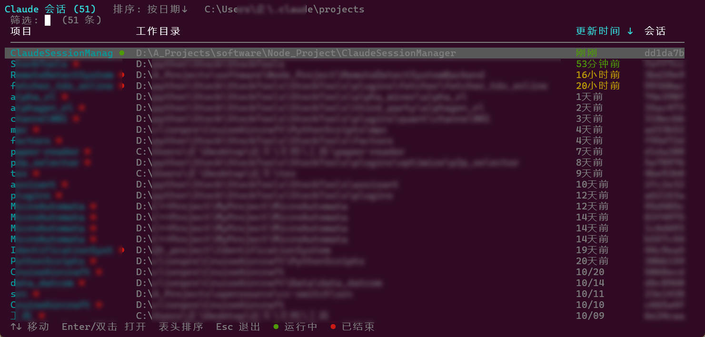

# ai-agent-session-manager

使用 Node.js 实现的终端 TUI，用于管理 AI Agent 的会话记录：列出本机已有的会话，选中后直接恢复继续。

目前只实现了 Windows 下 Claude Code 的会话管理，其他 agent（如 Codex）尚未接入。



## 环境

- Node.js 18 及以上
- Windows 10/11 + Windows Terminal（鼠标点击需要终端支持 SGR 鼠标协议，旧版 conhost 只能用键盘）
- 已安装 Claude Code CLI，`claude` 命令在 PATH 中

## 安装

```powershell
npm install -g ai-agent-session-manager
```

安装后运行 `agent-sm` 启动。

也可以从源码运行：

```powershell
git clone https://github.com/qinyun233/ai-agent-session-manager.git
cd ai-agent-session-manager
npm start
```

## 使用

启动后显示会话列表，按修改时间倒序，最新的在最前面。

- 项目名后的圆点：绿色 = 该会话的 claude 进程仍在运行，红色 = 已结束
- 点击表头（项目 / 工作目录 / 更新时间 / 会话）：按该列排序，再点一次切换正序/倒序
- 单击选中，双击或 Enter 打开会话；会话结束后自动回到列表
- 滚轮滚动，↑↓ 移动，输入关键字按项目名、路径、会话 id 过滤，Esc 退出

## 配置

配置文件为项目根目录的 `config.json`，也可用 `--config <path>` 或环境变量 `CLAUDE_SESSION_MANAGER_CONFIG` 指定。

| 配置项 | 说明 | 默认值 |
| --- | --- | --- |
| `projectsDir` | Claude 会话记录目录，支持 `~` | `~/.claude/projects` |
| `sessionsDir` | 运行中会话的状态目录，支持 `~` | `~/.claude/sessions` |
| `command` | 恢复会话的命令模板，必须包含 `{sessionId}` | `claude --resume {sessionId}` |
| `sort` | 初始排序：`time` / `name` / `path` / `id` | `time` |
| `order` | 排序方向：`asc` / `desc` | 时间 `desc`，其余 `asc` |

命令模板另支持 `{cwd}`、`{projectDir}`、`{projectName}` 占位符，路径类会自动加引号。命令会在会话的工作目录下执行，因此换成其他 agent 只需改这一项。

## 工作流程

1. 启动时读取 `config.json`，确定会话目录、状态目录和恢复命令。
2. 扫描 `projectsDir`：每个 `<uuid>.jsonl` 文件就是一个会话，文件名即会话 id，同时记录文件修改时间。
3. 逐个打开会话文件，只读到第一个 `cwd` 字段就停止，得到会话的真实工作目录（项目文件夹名是有损编码，无法反推路径）。
4. 读取 `sessionsDir` 下按 PID 命名的状态文件，确认 PID 存在、且进程名是 claude，标记该会话为运行中。
5. 按配置排序并渲染列表，支持输入关键字实时过滤；界面每 2 秒刷新一次存活状态。
6. 选中会话后退出 TUI，在该会话的工作目录下执行 `command`（默认 `claude --resume <会话id>`），把终端交给 claude。
7. claude 退出后重新扫描目录，回到列表，可以继续选择下一个会话。