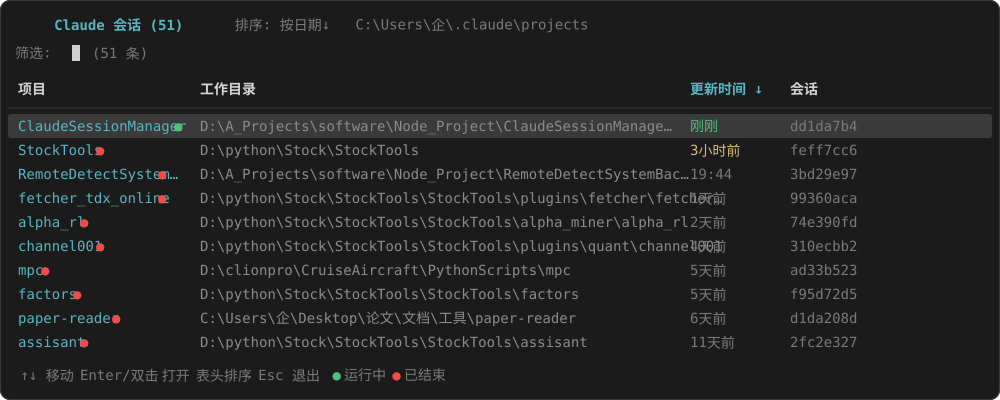

# Claude Session Manager

列出本机所有 Claude Code 会话，选一个直接 `claude --resume` 继续。纯 Node 实现，无第三方依赖。



## 环境

- Node.js 18 及以上
- Windows 10/11 + Windows Terminal（鼠标点击需要终端支持 SGR 鼠标协议，旧版 conhost 只能用键盘）
- 已安装 Claude Code CLI，`claude` 命令在 PATH 中

## 快速开始

```powershell
git clone https://github.com/qinyun233/ai-agent-seesion-manager.git
cd ai-agent-seesion-manager
npm start
```

## 使用

启动后显示会话列表，按修改时间倒序，最新的在最前面。

- 项目名后的圆点：绿色 = 该会话的 claude 进程仍在运行，红色 = 已结束
- 点击表头（项目 / 工作目录 / 更新时间 / 会话）：按该列排序，再点一次切换正序/倒序
- 单击选中，双击或 Enter 打开会话；会话结束后自动回到列表
- 滚轮滚动，↑↓ 移动，输入关键字按项目名、路径、会话 id 过滤，Esc 退出

不进入交互界面时：

```powershell
npm run list                              # 纯文本表格
node src/index.js --json                  # JSON，便于脚本处理
node src/index.js --open dd1da7b4         # 按 id 前缀直接打开
node src/index.js --sort name --order asc # 指定排序
```

## 配置

配置文件为项目根目录的 `config.json`，也可用 `--config <path>` 或环境变量 `CLAUDE_SESSION_MANAGER_CONFIG` 指定。

| 配置项 | 说明 | 默认值 |
| --- | --- | --- |
| `projectsDir` | Claude 会话记录目录，支持 `~` | `~/.claude/projects` |
| `sessionsDir` | 运行中会话的状态目录，支持 `~` | `~/.claude/sessions` |
| `command` | 恢复会话的命令模板，必须包含 `{sessionId}` | `claude --resume {sessionId}` |
| `sort` | 初始排序：`time` / `name` / `path` / `id` | `time` |
| `order` | 排序方向：`asc` / `desc` | 时间 `desc`，其余 `asc` |

命令模板另支持 `{cwd}`、`{projectDir}`、`{projectName}` 占位符，路径类会自动加引号。命令会在会话的工作目录下执行，因此换成其他 agent（例如 Codex）只需改这一项。

## 说明

- 会话 id 就是 `~/.claude/projects/<项目>/<uuid>.jsonl` 的文件名。
- 项目文件夹名是路径的有损编码（中文、下划线、分隔符都会变成 `-`），无法还原，所以工作目录取自会话文件里第一个 `cwd` 字段，只读到该字段就停止。
- 存活判断会确认 PID 存在且进程名是 claude，避免 PID 被复用导致误报。